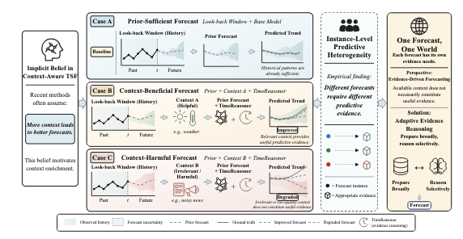
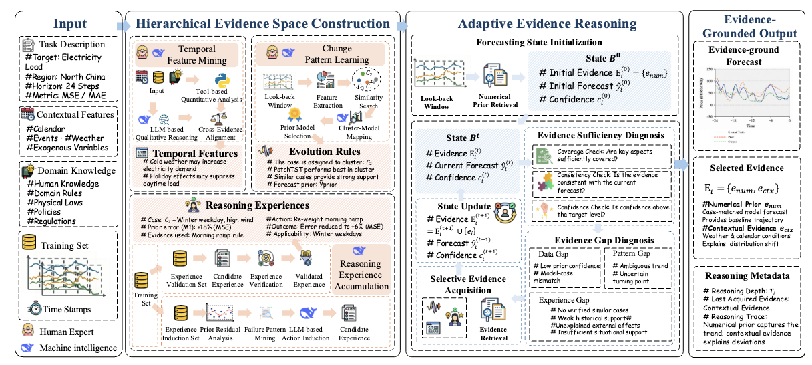
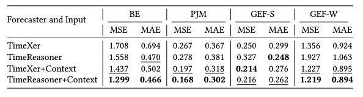
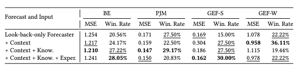
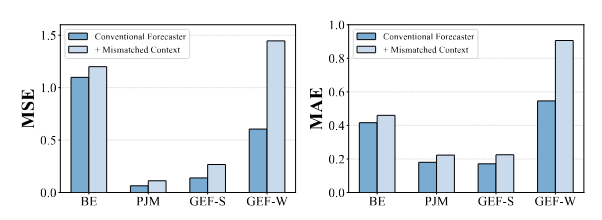
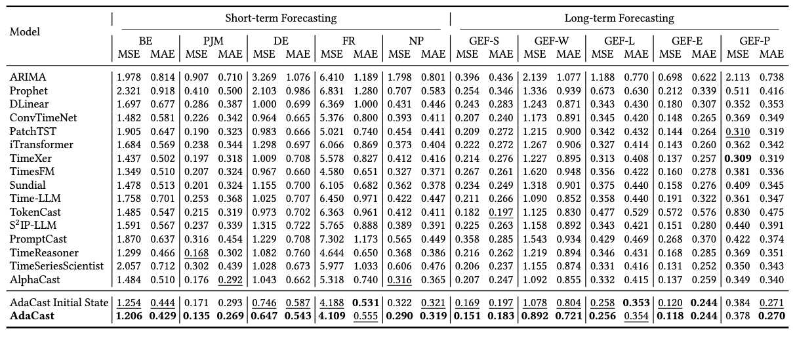

<div align="center">
  <h1>AdaCast</h1>
  <p><strong>One Forecast, One World: Adaptive Evidence Reasoning for Context-Aware Time Series Forecasting</strong></p>
  <p>An agentic forecasting framework that prepares evidence broadly and reasons selectively for each forecast.</p>
</div>

## Overview

Context-aware forecasting methods often assume that supplying more information will produce a better forecast. AdaCast starts from a different observation: even within the same domain, individual forecasts can require very different predictive evidence. Historical patterns may already be sufficient for one instance, relevant context may help another, and irrelevant context may harm a third.

We call this phenomenon **instance-level predictive heterogeneity**. AdaCast addresses it by constructing a broad candidate evidence space and adaptively selecting only the evidence needed by the current forecast.

<p align="center">
  
</p>

## Method

AdaCast consists of two main stages: hierarchical evidence space construction and adaptive evidence reasoning.

<p align="center">
  
</p>

### Hierarchical evidence space

AdaCast organizes predictive information into three complementary evidence libraries:

| Evidence type | What it captures | Role in forecasting |
| --- | --- | --- |
| Temporal features | Historical-series characteristics, contextual variables, calendar effects, events, and domain knowledge | Explains recurring temporal effects and distribution changes |
| Evolution rules | Mappings from recurring instance patterns to suitable small forecasters | Selects an instance-specific model and produces the numerical prior |
| Reasoning experiences | Verified correction actions distilled from previously solved forecasting cases | Provides reusable, executable guidance for forecast revision |

Candidate evidence is constructed from time-safe information available at the forecast origin. Qualitative reasoning is cross-checked with quantitative analysis, and correction experiences are retained only when they improve the corresponding prior on historical data.

### Adaptive evidence reasoning

For each forecasting instance, AdaCast:

1. selects a case-matched forecaster and initializes the forecasting state with its numerical prior;
2. evaluates evidence coverage, consistency, and forecast confidence;
3. diagnoses unresolved data, pattern, or experience gaps;
4. retrieves the most relevant unused evidence and updates the state; and
5. stops when the forecast is sufficiently supported or no useful evidence remains.

The final output contains not only a forecast, but also the selected evidence, confidence, stopping reason, and reasoning trace. This makes the forecast-specific evidence composition inspectable.

## Why adaptive evidence selection?

Adding context improves average forecasting performance, but its effect varies substantially across individual instances and datasets.

<p align="center">
  
</p>

Uniformly adding context, knowledge, and experience does not guarantee monotonic improvement. The best evidence composition changes from one forecast to another.

<p align="center">
  
</p>

Evidence quality also matters: mismatched context can consistently increase prediction error.

<p align="center">
  
</p>

These observations motivate AdaCast's central principle: **prepare broadly, reason selectively**.

## Experimental results

The paper evaluates AdaCast on ten public energy forecasting tasks:

- short-horizon electricity-price forecasting on BE, PJM, DE, FR, and NP;
- long-horizon solar, wind, load, electricity, and price forecasting on GEF-S, GEF-W, GEF-L, GEF-E, and GEF-P.

Evaluation uses mean squared error (MSE) and mean absolute error (MAE), where lower is better. AdaCast obtains the best result on 19 of 20 reported metrics. Relative to its instance-specific numerical initial state, adaptive evidence reasoning reduces MSE on all ten tasks, with an average relative reduction of 8.2%.

<p align="center">
  
</p>

Further analyses in the paper show that:

- temporal-feature and reasoning-experience evidence are both useful, but their contributions are task-dependent;
- adaptive acquisition outperforms fixed-order and random evidence selection;
- no single fixed reasoning depth is optimal across all tasks; and
- the framework remains effective across different reasoning backbones.

## Getting started

### Requirements

- [Bun](https://bun.sh/) 1.3.11
- [uv](https://docs.astral.sh/uv/)
- Python 3.12 (automatically selected from `python/.python-version` by uv)
- credentials for a supported LLM provider

The standard source workflow does not require Rust. Rust is only used by specialized container/build tooling in this repository.

### Install from source

From the repository root:

```bash
bun install
uv sync --project python
```

Optional foundation-model dependencies, including Chronos, TimesFM, Moirai, and TiRex, can be installed with:

```bash
uv sync --project python --extra heavy-models
```

### Start AdaCast

Create a workspace containing, or able to access, your forecasting dataset and launch the terminal interface:

```bash
bun run dev -- /path/to/forecast-workspace
```

In the terminal interface:

1. run `/connect` to configure an LLM provider;
2. run `/models` to select a reasoning model; and
3. describe the forecasting task to the Planner, including the dataset path, timestamp column, target column, look-back length, prediction horizon, split strategy, metrics, and candidate model families.

For example:

```text
Forecast the load column in /absolute/path/to/load.csv.
Use timestamp as the time column, a 168-step look-back window,
a 24-step horizon, a 70/20/10 chronological split, MSE and MAE.
```

AdaCast will summarize the task before freezing its evaluation contract. It then moves through planning, forecasting, and evidence-based critique while keeping validation and test targets separated.

### Input data

The forecasting interface expects a CSV file with:

- one timestamp column;
- one numeric target column; and
- optional numeric or categorical exogenous/context columns.

A minimal example is:

```csv
timestamp,load,temperature,holiday
2025-01-01 00:00:00,102.4,-2.1,1
2025-01-01 01:00:00,98.7,-2.4,1
```

Additional business context, regional information, known seasonality, events, anomaly periods, and expert rules can be supplied in the task description.

### Inspect a run

Run the following command from a forecast workspace:

```bash
bun run --cwd /path/to/AdaCast/packages/adacast dev -- forecast status
```

AdaCast stores run artifacts under `.forecast/`, including the frozen task definition, experiment history, reports, visualizations, and reasoning artifacts.


## Repository structure

```text
.
├── assets/                 Paper figures used in this README
├── packages/adacast/       CLI, agent workflow, evidence tools, and server
├── packages/app/           Local web application
├── packages/sdk/           JavaScript SDK
├── packages/ui/            Shared user-interface components
├── python/                 Forecasting models, evaluation, and evidence utilities
├── infra/                  Deployment configuration
└── nix/                    Nix packaging
```

## Development and tests

```bash
# TypeScript type checking
bun run typecheck

# AdaCast CLI tests
bun run --cwd packages/adacast test

# Python tests
uv run --project python pytest python/tests
```

Some foundation-model tests require the optional `heavy-models` dependency group and may download pretrained checkpoints.
